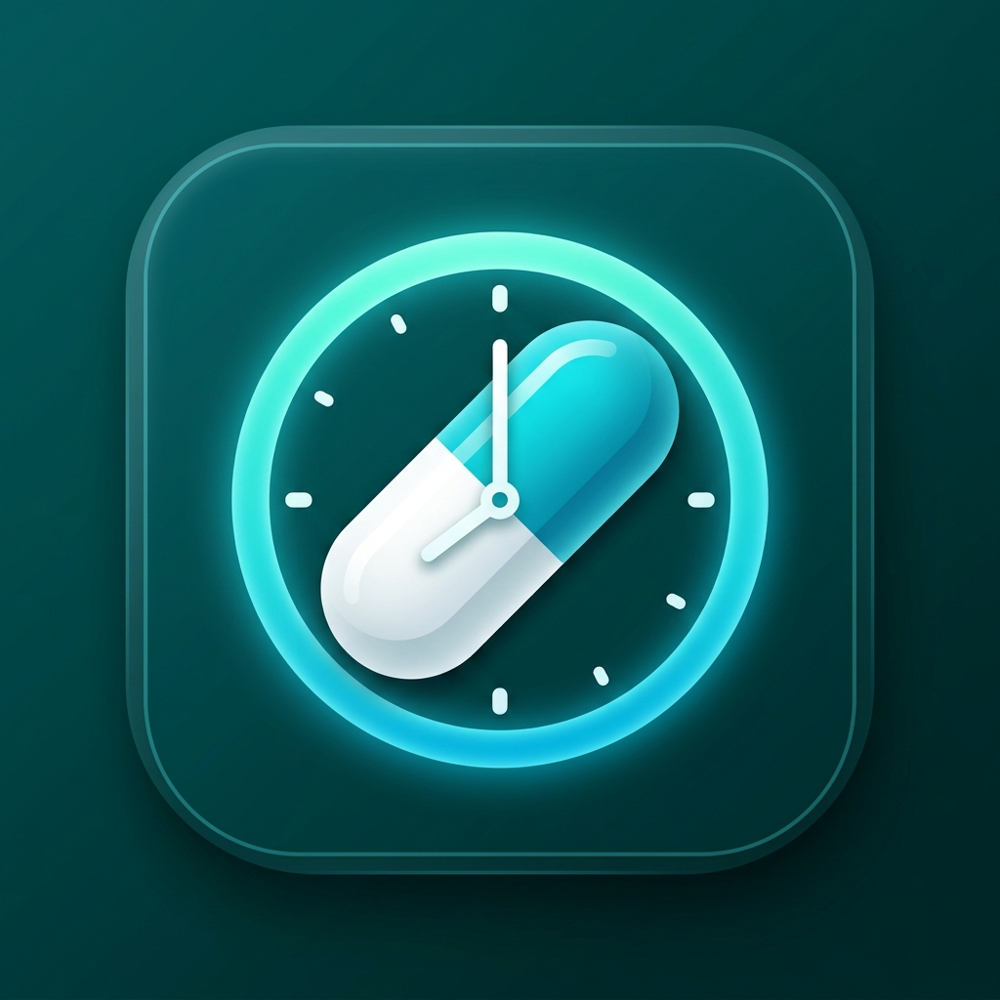

<p align="center">
  
</p>

# 💊 MediRemind — Asistente Inteligente y Recordatorio de Medicamentos para Android

<p align="center">
  
  
  
  
  
  
</p>

---

## 📌 Visión General

**MediRemind** es una aplicación móvil nativa para Android construida con **Kotlin** y **Jetpack Compose (Material 3)**, diseñada para solucionar el problema clínico del olvido y la falta de adherencia al tratamiento médico. 

El sistema combina **alarmas de precisión exacta inmunes al modo de ahorro de batería (Doze Mode)**, un **mecanismo de registro extemporáneo de dosis** con hora real y cálculo dinámico de retraso, una **base de datos farmacológica híbrida (Room local + OpenFDA REST API)**, y **sensores de geolocalización (GPS)** con radar de farmacias y geovallas preventivas.

---

## 📚 Documentación Técnica Oficial

Toda la documentación técnica de ingeniería y arquitectura se encuentra disponible en la carpeta [`/docs`](docs/):

| Documento | Descripción | Enlace |
| :--- | :--- | :--- |
| **📑 Documento Técnico de Arquitectura** | Especificación formal del sistema, patrones Clean/MVVM, principios SOLID, seguridad y compilación. | [Ver Documento Técnico](docs/DOCUMENTO_TECNICO.md) |
| **📖 Diccionario de Funciones** | Catálogo exhaustivo de todas las clases, entidades, DAOs, repositorios, métodos y firmas de código. | [Ver Diccionario de Funciones](docs/DICCIONARIO_DE_FUNCIONES.md) |
| **📐 Diagramas y Arquitectura** | Diagramas Mermaid de capas, base de datos relacional (ERD), secuencias temporales y navegación UI. | [Ver Diagramas](docs/DIAGRAMAS_Y_ARQUITECTURA.md) |
| **📋 Requerimientos de Software (SRS)** | Matriz de requerimientos funcionales (RF-01 al RF-15), no funcionales (RNF-01 al RNF-10) y trazabilidad. | [Ver Requerimientos](docs/REQUERIMIENTOS.md) |
| **📋 Ficha Técnica** | Resumen ejecutivo de plataforma, dependencias, consumo de batería y matriz de permisos. | [Ver Ficha Técnica](docs/FICHA_TECNICA.md) |

---

## 🌟 Características Principales

### 1. ⏰ Alarmas Exactas y Notificaciones Interactivas
- Empleo de `AlarmManager.setExactAndAllowWhileIdle()` con soporte para `USE_EXACT_ALARM` en Android 13/14.
- Canal de notificación con sonido de alarma, vibración y visibilidad en pantalla de bloqueo.
- **Acciones directas en la notificación**: botones `✅ Tomar` (descuenta inventario y guarda la toma sin abrir la app) y `⏰ Posponer 10m`.
- **Receptor post-reinicio (`BootReceiver`)**: Reprograma automáticamente todas las alarmas en el kernel de Android al encender el teléfono.

### 2. 🕒 Registro Extemporáneo con Hora Real de Toma
- **¿Qué pasa si la alarma sonó y no tomaste el medicamento en ese instante?**
  - La app permite registrar la toma horas después indicando la hora exacta en que realmente ingeriste el fármaco (`Poner Hora` o `Registrar Toma`).
  - Presets rápidos: *"Justo ahora"*, *"-15 min"*, *"-30 min"*, o selección exacta con `TimePickerDialog`.
  - **Cálculo dinámico de retraso**: almacena tanto la hora programada (`scheduledTimeMillis`) como la hora real de ingesta (`actionTimeMillis`), mostrando etiquetas como `⚠️ +1h 45m de retraso` en el historial.

### 3. 🔬 Base de Datos Médica Híbrida (Compuesto, Presentación y Stock)
- **Base de datos local Room (SQLite)**:
  - Campos clínicos: principio activo/compuesto químico, forma farmacéutica (tableta, jarabe, inhalador, etc.), concentración (ej. 500 mg, 100 mg/5 ml), vía de administración e instrucciones.
  - **Catálogo precargado (`PreloadedMedications`)**: decenas de medicamentos esenciales listos para su uso 100% offline.
  - **Control de inventario**: stock disponible, unidades físicas y alerta automática de stock bajo ($\le 5$).
- **Integración con OpenFDA API**:
  - Conexión REST directa a la base de datos nacional NDC de la FDA para buscar principios activos y dosificaciones oficiales con importación en 1 clic.

### 4. 📍 Geolocalización, Radar de Farmacias y Geovallas
- **Radar GPS de Farmacias**: Detección de establecimientos cercanos con cálculo trigonométrico de distancia real (fórmula del Semiverseno / Haversine), sucursales 24 horas y apertura directa en Google Maps.
- **Geovallas Inteligentes (Geofencing)**: Monitoreo perimetral para "Casa" y "Trabajo" (radio de 150m) que emite recordatorios contextuales al arribar al domicilio si existen dosis pendientes del día.

### 5. 🔐 Autenticación con Google y Privacidad
- Integrado con la API moderna de **Credential Manager** (`androidx.credentials`) y Google Identity Services.
- **Modo Invitado / Offline**: Permite usar todas las funciones sin cuenta vinculada.
- **Modo de Prueba**: Simula inicios de sesión para pruebas rápidas en Android Studio o emuladores.

---

## 📂 Estructura del Repositorio

```
App-Medicina/
├── app/
│   ├── build.gradle.kts                # Dependencias (Compose, Room, Play Services, Retrofit, KSP)
│   ├── proguard-rules.pro              # Reglas de optimización ProGuard/R8
│   └── src/main/
│       ├── AndroidManifest.xml         # Declaración de permisos, receptores y aplicación
│       ├── java/com/mediremind/app/
│       │   ├── MediRemindApp.kt        # Application class (inicialización de canales)
│       │   ├── MainActivity.kt         # Actividad principal y gestor de permisos en runtime
│       │   ├── data/
│       │   │   ├── local/              # Base de datos Room, entidades, DAOs y catálogo inicial
│       │   │   ├── remote/             # Cliente OpenFDA (Retrofit, Gson, modelos DTO)
│       │   │   └── repository/         # Repositorios (Medicación, Recordatorios, GPS, Auth)
│       │   ├── notification/           # AlarmReceiver, NotificationActionReceiver, BootReceiver, Helper
│       │   ├── location/               # LocationHelper (Haversine), GeofenceManager, Receiver
│       │   └── ui/
│       │       ├── theme/              # Paleta Teal/Mint, tipografía y tema Material 3
│       │       ├── navigation/         # NavGraph declarativo y rutas BottomNavigation
│       │       ├── screens/            # Pantallas (Auth, Home, Medicinas, Farmacias, Geovallas, Historial)
│       │       └── viewmodels/         # ViewModels con flujos StateFlow reactivos
│       └── res/                        # Strings, colores, temas XML y reglas de extracción
├── docs/                               # 📁 Documentación formal de ingeniería
│   ├── DOCUMENTO_TECNICO.md            # Documento técnico completo
│   ├── DICCIONARIO_DE_FUNCIONES.md     # Diccionario y referencia de API
│   ├── DIAGRAMAS_Y_ARQUITECTURA.md     # Diagramas en Mermaid (Capas, ERD, Secuencia, Flujo)
│   ├── REQUERIMIENTOS.md               # Especificación de Requerimientos (SRS)
│   └── FICHA_TECNICA.md                # Resumen de ficha técnica
├── .gitignore                          # Exclusiones completas para Android Studio y Gradle
├── CHANGELOG.md                        # Historial cronológico de versiones
├── CONTRIBUTING.md                     # Guía de contribución y estilo de código
├── LICENSE                             # Licencia MIT de código abierto
├── SECURITY.md                         # Políticas de reporte de vulnerabilidades
├── build.gradle.kts                    # Configuración de plugins de Gradle raíz
├── settings.gradle.kts                 # Módulos y repositorios (Google, MavenCentral)
└── gradle.properties                   # Opciones de compilación JVM y AndroidX
```

---

## 🚀 Guía de Instalación y Ejecución

### Prerrequisitos
- **Android Studio:** Versión Iguana, Jellyfish o posterior.
- **Java Development Kit (JDK):** JDK 17 o superior.
- **Dispositivo o Emulador:** Android 8.0 (API 26) o superior con Google Play Services.

### Pasos
1. **Clonar el repositorio:**
   ```bash
   git clone https://github.com/tu-usuario/App-Medicina.git
   ```
2. **Abrir en Android Studio:**
   - Selecciona **File > Open...** y elige la carpeta del proyecto.
   - Espera a que Gradle descargue las dependencias y sincronice el proyecto.
3. **Compilar y Ejecutar:**
   - Conecta un teléfono con depuración USB o inicia un emulador.
   - Haz clic en **Run 'app'** (`Shift + F10`).

---

## 📄 Licencia

Este proyecto está distribuido bajo la licencia de código abierto **MIT**. Consulta el archivo [`LICENSE`](LICENSE) para obtener más información.
