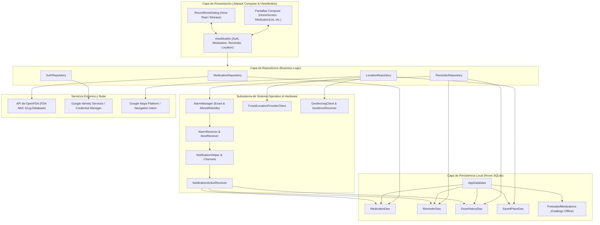
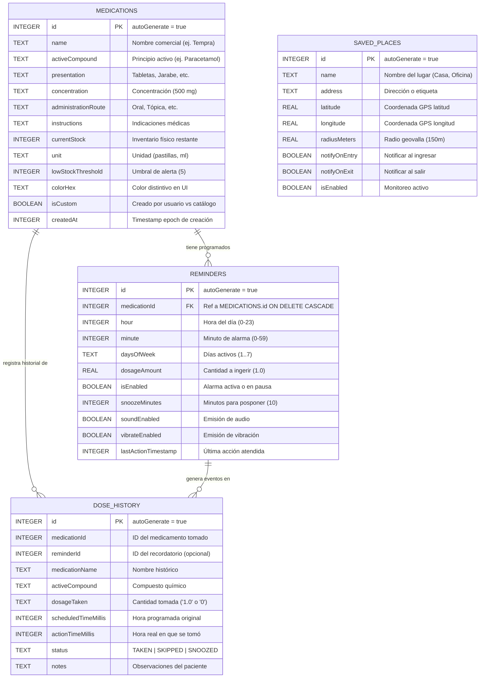
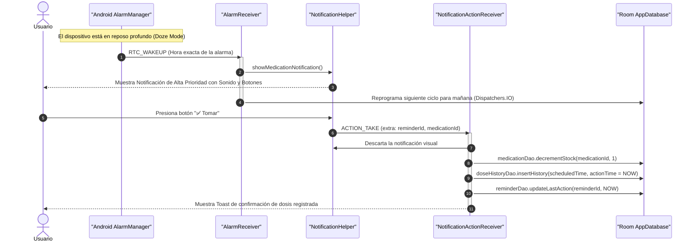
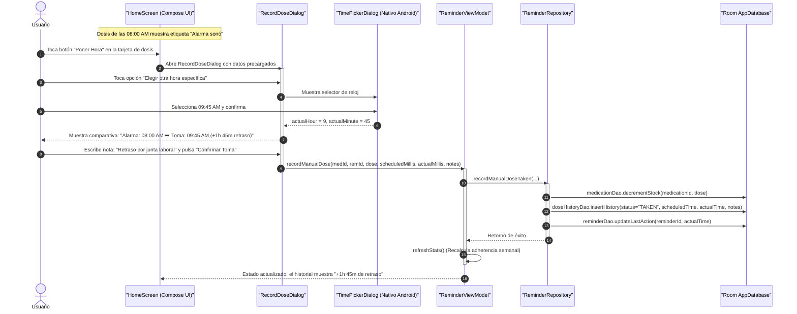
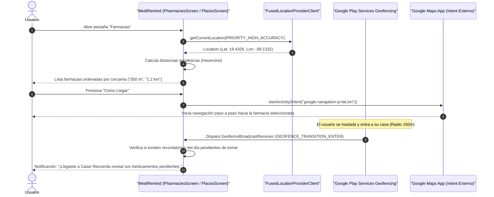
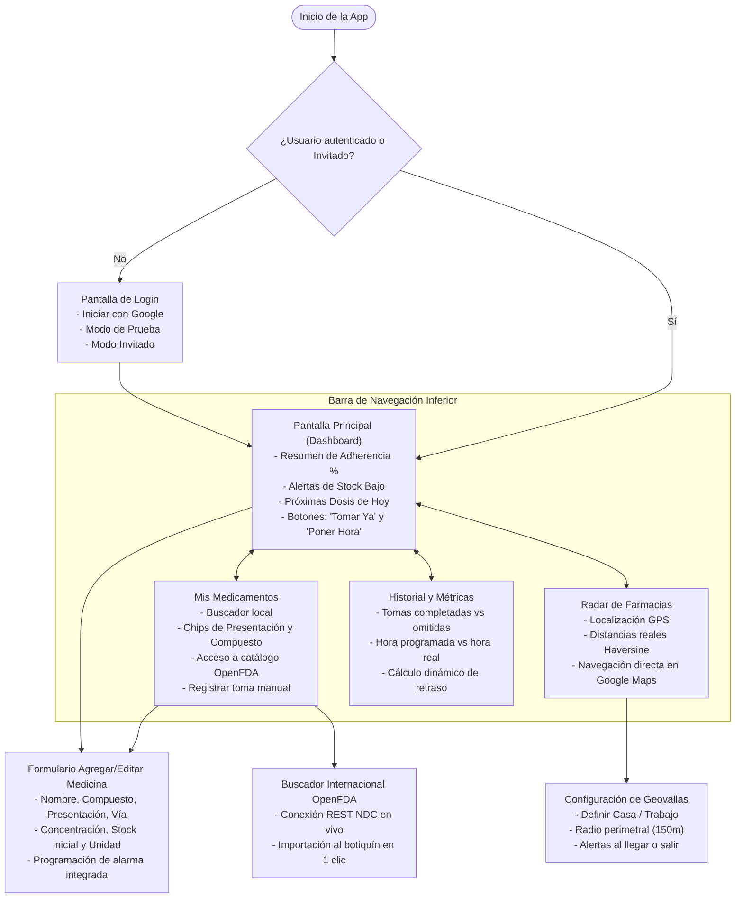

# 📐 DIAGRAMAS DE ARQUITECTURA Y FLUJOS DEL SISTEMA

Este documento contiene los diagramas técnicos modelados en **Mermaid** que describen la arquitectura, la base de datos relacional, las secuencias de ejecución y los flujos de navegación de la aplicación **MediRemind**.

---

## 1. Diagrama de Arquitectura de Capas (Clean Architecture + MVVM)

---

## 2. Diagrama Entidad-Relación de la Base de Datos (Room SQLite)

---

## 3. Diagrama de Secuencia: Disparo de Alarma Exacta y Acción Rápida en Notificación

Este flujo describe cómo se emite la alarma en el milisegundo exacto, incluso si el dispositivo se encuentra en reposo profundo (*Doze Mode*), y cómo el paciente puede confirmar la toma directamente desde la barra de notificaciones.

---

## 4. Diagrama de Secuencia: Registro Extemporáneo de Toma con Selección de Hora Real

Este flujo resuelve el requerimiento específico cuando la alarma sonó previamente (por ejemplo, a las 08:00 AM), el paciente no pudo tomar la dosis en ese momento, pero horas después (ej. 09:45 AM) registra la toma indicando la hora exacta en que ingirió el fármaco.

---

## 5. Diagrama de Secuencia: Radar de Farmacias y Monitoreo de Geovallas

---

## 6. Diagrama de Flujo de Navegación de la Aplicación

